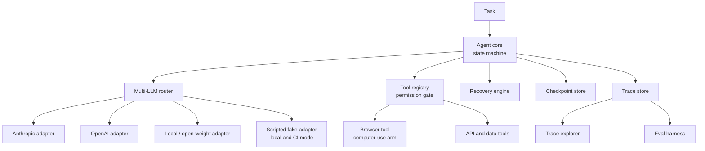

# Aegis Architecture

Aegis is a runtime for tool-using agents that is built around three
convictions:

1. An agent should never be able to do something irreversible without a
   human saying yes, and the check should live in the runtime, not in a
   prompt.
2. Long tasks fail in the middle, not at the start. The runtime needs
   checkpoints, a failure taxonomy, and recovery moves that are planned,
   not improvised.
3. If a run cannot be replayed from its records, its results cannot be
   trusted. Every step is traced, and every number the project publishes
   comes from an eval run over those traces.

This document describes the design. Where Phase 1 implements a piece, the
module is named. Where a piece is designed but not yet built, it says so.

## System overview

## (a) Agent core: checkpointed state machine

Module: `src/aegis/core/state_machine.py`, `src/aegis/core/checkpoints.py`.

The core is a state machine with six states, following the LangGraph-style
checkpointed graph pattern: explicit states, transitions recorded as data,
durable checkpoints between steps.

- **PLAN**: one model call turns the task text and the tool declarations
  into a step list. Each step names a tool, its arguments, and optionally
  an expected substring used by VERIFY. Plans are capped by a max step
  count so a bad plan cannot loop forever.
- **ACT**: one step executes through the tool registry (never directly).
  The registry applies the permission gate, runs the handler, and returns
  a structured result with latency.
- **VERIFY**: the step result is checked before the run moves on.
  Phase 1 verification is programmatic: the call succeeded and, when the
  step declares an expectation, the output contains it. Model-based
  verification (a VERIFY step-kind call through the router, for steps
  whose success is a judgement call) plugs into the same state in Phase 2.
- **RECOVER**: any failure, from any state, lands here. The recovery
  engine classifies the failure and picks a move (see (e)). The run
  returns to ACT on a retry, restores state on a rollback, or ends.
- **DONE / FAILED**: terminal states. A failed run carries its diagnosis,
  not just an error string.

After every VERIFY pass, the runner writes a **checkpoint**: the set of
completed steps and their outputs, stored as one JSON record per run.
Checkpoints are what make rollback and crash resume possible: the run can
restart from the last verified step instead of from zero.

Phase 1 implements this as a direct state machine with the graph shape
above. Binding a graph library (LangGraph) is a Phase 2 swap behind the
same runner interface; the states, transitions, and checkpoint contract do
not change.

## (b) Permissioned tool registry

Module: `src/aegis/tools/registry.py`.

Every tool is declared as a `ToolSpec` before the agent can use it:

- **Permission scope**, one of four:
  - `read`: observe only. Fetch, read, search, screenshot.
  - `write`: create or change data in ways that are reversible in
    principle. Write a file, append a record, draft a document.
  - `act`: do something in the world. Click submit, send a message,
    change a setting.
  - `spend`: move money or consume paid quota. A purchase, a paid API
    tier call.
- **Run policy**: timeout budget and retry budget for the tool.
- **Irreversibility flag**: true when the action cannot be undone (a sent
  message, a charge, a deleted record).

**Approval gates.** A tool that is irreversible, or whose policy sets
`requires_approval`, cannot execute without an approval decision. The
registry asks an approval function, which in production is wired to a
human (a prompt in the UI, an async approval queue) and in tests is an
explicit callable. Two properties matter:

- There is no default-yes. If no approval function is configured, gated
  tools are blocked, full stop.
- The recovery engine treats `permission_denied` as final. The agent
  never retries around a gate, rephrases its way past one, or splits an
  action into smaller pieces to stay under it. If a human said no, or has
  not said yes, the run stops and reports that.

The registry is the only path from the core to a handler, so a plan the
model invents cannot reach a tool that was not declared, and cannot skip
the gate for one that was.

## (c) Browser and computer-use arm

Designed here; the tool itself is Phase 2 work. It registers in the same
registry as any other tool, split into `read` tools (observe the page),
`act` tools (click, type, submit).

The browser tool follows three rules learned from driving real web
interfaces:

1. **Semantic grounding, not coordinates.** Elements are located by role
   and accessible label (the button whose label is "Export report", the
   textbox labelled "Email"), the same information a screen reader uses.
   Coordinate clicking breaks when a layout shifts; a role and label
   survive most redesigns and, when they do not, fail in a classifiable
   way (`element_not_found`) instead of clicking the wrong thing.
2. **Verify after every step.** Each browser action is followed by an
   observation: did the expected element, text, or URL change appear?
   This is the VERIFY state applied at tool level, so a click that did
   nothing is caught at that step, not three steps later.
3. **Failures feed the recovery engine.** A missing element, a page that
   changed mid-task (`stale_state`), or a timeout is returned as a typed
   failure, not an exception dump. The recovery engine's strategy table
   maps `element_not_found` to re-grounding with a wider role and label
   search, which is how the agent handles pages that render controls only
   after some earlier interaction.

A local test site (static pages served on localhost, including pages that
deliberately misbehave: late-rendered buttons, changed labels, a form that
rejects the first submit) is part of the eval suite, so browser behavior
is measured against pages that are allowed to be hostile, without ever
touching a real account in an eval.

## (d) Multi-LLM router

Modules: `src/aegis/models/adapter.py`, `src/aegis/models/router.py`,
`src/aegis/models/fake.py`.

Different steps are different jobs. Planning wants the strongest reasoner
available. Verification wants a fast, cheap, literal checker. Diagnosis
wants a model that is good at reading error output. The router therefore
selects a model **per step kind** (`plan`, `act`, `verify`, `diagnose`):

- Each provider sits behind one **adapter interface** (`ModelAdapter`):
  a request with a step kind, a prompt, and context; a response with
  text, token counts, latency, and cost. Planned adapters: Anthropic,
  OpenAI, and a local or open-weight adapter speaking to a self-hosted
  endpoint. Provider SDKs and keys live inside adapters only.
- **Fallback chains**: each step kind has an ordered list of adapters. A
  provider error moves the call to the next adapter in the chain and is
  itself recorded in the trace as a `model_call_failed` event, so silent
  degradation is impossible: if the run finished on a fallback model, the
  trace says which step and why.
- **Cost and latency logging**: every call emits a `model_call` trace
  event with input and output tokens, latency, and cost computed from a
  per-model price table. Run totals are sums over these events, never
  estimates made after the fact.
- **Local deterministic mode**: the scripted fake adapter answers from a
  script, with no key and no network. Local runs, tests, and CI use it,
  which is what makes the whole system testable before any provider is
  connected. Its price is zero and its trace events say `fake-scripted`,
  so fake runs can never be mistaken for real ones in a results table.

## (e) Recovery engine

Module: `src/aegis/recovery/engine.py`.

**Failure taxonomy.** Every failure is classified into one kind:

| Kind | Meaning |
| --- | --- |
| `element_not_found` | Browser target not on the page |
| `stale_state` | Page or data changed under the run |
| `tool_error` | Tool handler raised or returned an error |
| `model_refusal` | Model declined to produce the requested output |
| `timeout` | Tool or model exceeded its budget |
| `permission_denied` | Approval gate blocked the call |
| `verify_failed` | Step ran, but its check failed |
| `unknown` | Anything not yet classified |

**Diagnosis.** For each failure the engine produces a diagnosis string:
the step, the kind, the tool, and the detail. It is written into the
`recovery_event` trace record, so the reasoning is auditable afterwards,
not locked in a log line.

**Moves.** Exactly three:

- **Retry with a changed strategy.** Never the identical call repeated
  blindly. The strategy is chosen from the failure kind: re-ground with a
  wider search for a missing element, re-read state and replan the step
  for stale state, backoff and a reduced payload for a tool error, one
  extended timeout for a timeout, a rephrased request for a refusal. A
  per-step retry budget bounds this.
- **Rollback.** When the retry budget is spent on a state-shaped failure
  (`stale_state`, `verify_failed`), the run restores the last verified
  checkpoint and retries the step from known-good state, once.
- **Abort.** The run ends with its diagnosis. Permission denials abort
  immediately, always.

**Ablation switch.** The engine has an `enabled` flag. With it off, every
failure aborts. That flag exists for one reason: the eval harness runs
the suite with recovery on and off, so the value of recovery is a
measured number, not a claim. The end-to-end example this design is built
to reproduce and then beat: an agent whose step success improves by a
large, measured margin when recovery is switched on, on tasks designed to
fail midway.

## (f) Trace store

Module: `src/aegis/trace/store.py`.

Every run writes a JSONL trace: one structured event per line, with a run
id, a sequence number, a timestamp, an event type, and a payload. Event
types in Phase 1: `run_started`, `model_call`, `model_call_failed`,
`plan_created`, `state_transition`, `tool_call`, `step_verified`,
`recovery_event`, `run_finished`.

Design points:

- **Append-only and ordered.** Events are never edited. The sequence
  number makes the order explicit even if timestamps collide.
- **Queryable.** `read_events` filters by run id and event type. The
  trace explorer (Phase 3) is a read-only UI over exactly this: pick a
  run, walk its events, see the plan, each tool call and its arguments,
  each model call and its cost, each failure and the recovery move it
  triggered.
- **The single source of truth for results.** The eval harness scores
  runs from traces. Cost and latency totals are recomputed from events.
  If it is not in a trace, it did not happen, and it does not go in a
  report.

## (g) Eval harness

Modules: `src/aegis/evals/suite.py`, `src/aegis/evals/run.py` (loader in
Phase 1, execution in Phase 2). Suite format: `evals/tasks.example.json`.

**Task suite.** Tasks are data, not code: an id, a kind (`browser` or
`api`), the instruction text, optional setup, and a scorer declaration.
The suite mixes:

- **Browser tasks** against the local test site: login form completion,
  export flows, multi-page navigation, and deliberately hostile pages
  (late-rendered controls, changed labels, a first submit that fails) so
  that a run only passes if recovery works.
- **API and data tasks** against local stub services: read-transform-write
  chains, a write tool that fails transiently on the first attempt,
  multi-step tasks where a later step depends on an earlier output.

**Scoring.** Each task is pass or fail, judged by its scorer from the
final state and the trace (for example: the note contains the line, the
page shows the confirmation text). No partial credit, no model-graded
vibes; a task either did the thing or it did not.

**Ablations and metrics.** Every task runs at least twice per
configuration, recovery on and recovery off, on the same model route.
Reported per task and in aggregate: pass rate, mean cost per task, mean
latency per task, mean recovery events per passing run. The headline
comparison is pass rate with recovery on versus off. Phase 2 targets a
suite of 30 or more tasks; results are published only from harness runs,
with the suite version named next to the numbers.
