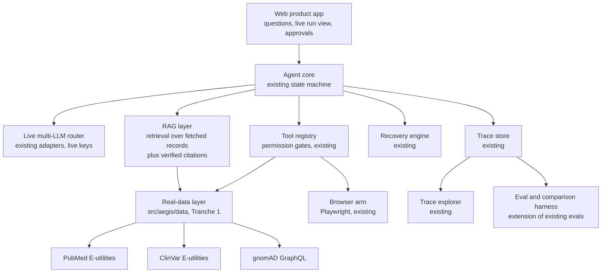

# Aegis Product Plan

This is the blueprint for Aegis v2. Version 1 built the runtime: a
checkpointed agent core, a permissioned tool registry, a recovery
engine, a multi-LLM router, full tracing, and an eval harness, all
measured on local scripted tasks. That foundation stays. What changes
in v2 is the purpose. Aegis is no longer only a showcase of how an
agent runtime should behave. It is being built as a real product, for
real users, in the one domain where the builder's record is deep:
bioinformatics and genomic evidence work.

Everything in this plan follows three product rules, stated once here
and enforced everywhere below:

1. **Real data only in the product path.** The product works on live
   public data (PubMed, ClinVar, gnomAD, and the sources that join
   them later). Fixtures and the local test site exist for tests, and
   only for tests.
2. **Every claim can be checked.** Every answer the product gives
   carries citations that point at the exact source record, and the
   system checks those citations itself before showing the answer.
3. **Results come from harness runs, not from writing.** No number
   about this product is published until the eval or comparison
   harness produced it from traces. Commands used are recorded in the
   build journal.

## (a) The product in one page

**What it is.** Aegis is an agent product for genomic evidence work.
A researcher, a bioinformatics analyst, or a small lab team gives it a
question about a gene or a variant: what is known about this variant,
how is it classified, how common is it in the population, what does
the literature say, and how strong is the evidence overall. Aegis runs
the task end to end: it plans the work, gathers evidence from live
public sources through declared tools, checks every citation against
the record it claims to come from, weighs the evidence, and returns a
sourced summary. Where the evidence is not strong enough, it declines
to conclude and says exactly what is missing. That decline rule is the
heart of the product, and it comes straight from the builder's
evidence agent work: an answer that admits its limits is worth more
than a confident answer built on nothing.

**Who it is for.** Small and mid size research and diagnostics teams
who do variant interpretation and genomic evidence review by hand
today, in spreadsheets and browser tabs. The product does not replace
their judgement. It does the gathering, checking, and record keeping
that eats their hours, and hands them an auditable file they can
defend.

**How a person uses it.** Through a web app. The user types a
question, watches the run happen step by step (which sources were
queried, what came back, what was checked), approves or refuses any
step that needs a human yes, and gets the final sourced summary with
its full trace attached. Every run can be reopened later and replayed
from its trace, which is what makes the output usable in a regulated
or publication facing setting.

**Why it can win.** General agent products demo well and fail
quietly: they invent citations, lose track of what they did, die on
the first failed tool call, and act without asking. Aegis is built,
mechanism by mechanism, against exactly those failures (section b),
in a domain where a wrong answer is not a shrug but a clinical or
scientific error, and where the sources of truth are public, stable,
and checkable. That combination, a runtime that refuses to guess plus
a domain where guessing is detectable, is the product's edge.

**What exists today.** The v1 runtime (agent core, permission gates,
recovery, router, tracing, eval harness, trace explorer, demo), real
provider adapters for three model families, and, as of v2 Tranche 1,
the first real-data layer: live clients for PubMed, ClinVar, and
gnomAD in `src/aegis/data/`, each returning records with source URLs
and fetch provenance. What does not exist yet is listed honestly in
section (e), phase by phase.

## (b) The real problems in current LLM and agent products, and the Aegis answer to each

| Problem in current products | What it looks like in practice | The Aegis mechanism that answers it | State |
| --- | --- | --- | --- |
| Hallucinated citations | The model names papers, accessions, or database records that do not exist, or that do not say what the answer claims | Citations are never written from model memory. Tools return records with source URLs, the answer may only cite records a tool actually returned, and a verification step checks each citation against its source record before the answer is shown (RAG layer, section c) | Data layer built in Tranche 1; citation checker is a named v2 phase |
| Unverified answers | A fluent answer is presented with no check between generation and the user | Verify after every step, at two levels: each tool step is verified programmatically before the run moves on, and the final answer passes an evidence check (every claim tied to a returned record) before release | Step verification built in v1; final answer check is a named v2 phase |
| No recovery | The first failed tool call, changed page, or flaky API ends the run, or the agent retries the identical call until a budget dies | Classified failure taxonomy with strategy changing retries and rollback to the last verified checkpoint, measured with recovery on and off (v1: 30 of 30 tasks with recovery on, 17 of 30 with it off, on the local suite) | Built and measured in v1 on local tasks; the comparison harness re-measures it on real tasks |
| No audit trail | After a run, nobody can say what the agent did, which model answered, or what anything cost | Append only JSONL traces of every state transition, model call (with tokens, latency, cost, and fallback events), tool call, verification, and recovery event; trace explorer renders any run as a timeline | Built in v1 |
| Agents acting without approval | An agent sends, deletes, charges, or submits because a prompt told it to be helpful | Permission scopes on every tool (read, write, act, spend) with code level approval gates for irreversible actions. No approval path means blocked. A denial is final; recovery never retries around a gate | Built in v1; the web app adds the human approval surface |
| Demos on fake data | The showcase runs on canned examples, so nothing about real world behaviour is learned | The product path runs on live public data only. The eval and comparison suites use real variants, genes, and questions with ground truth from source records (see COMPARISON.md) | Data layer built in Tranche 1; real task suite is a named v2 phase |
| Confident answers on insufficient evidence | The model concludes anyway, because concluding is what it was asked to do | Decline as a first class outcome: below a stated evidence bar, the run ends in a decline with the missing evidence named, and decline correctness is a scored metric, not a hope | Rule designed in the builder's evidence work; scored in the comparison harness |
| Cost and model opacity | The user cannot tell which model did the work or what a run cost | Per step model routing with fallback chains recorded in the trace, and per call cost and latency logged from the providers' own token counts | Built in v1; live provider verification is the first v2 phase |

## (c) Full architecture for v2

**Agent core (existing).** The six state machine (plan, act, verify,
recover, done, failed) with a checkpoint after every verified step.
Unchanged in v2; the new layers plug in behind its interfaces.

**Live multi-LLM router (existing adapters, live verification next).**
Anthropic, OpenAI, and local/open weight adapters behind one
interface, selected per step kind, with fallback chains and per call
cost and latency in the trace. The v2 change is operational, not
structural: real keys, a live planner run over the v1 suite, and the
same run standing as the baseline the product is measured against.

**RAG layer with verified citations (new).** Retrieval in this
product is not a vector search over a scraped corpus. It is, first,
structured retrieval: the agent's tools fetch records from named
public sources, and those records are the retrieval set. A later phase
may add vector retrieval over the fetched literature (the decision
criteria are in TOOLS_AND_MODELS.md). The layer's defining piece is
the citation checker: before an answer is released, every citation in
it is resolved to the record it claims (by PMID, ClinVar accession,
gnomAD variant id), and the claim next to the citation is checked
against that record's actual fields. A citation that does not resolve,
or a claim the record does not support, blocks the answer and is
written to the trace.

**Real-data layer (Tranche 1, built).** `src/aegis/data/`: PubMed,
ClinVar, and gnomAD clients, standard library only. Shared rules:
every record carries its source URL; failures are typed errors, never
silent empty results; a caller chosen on-disk cache makes runs
reproducible, and every record states whether it came from live fetch
or cache and when the live fetch happened. Further sources (for
example dbNSFP annotations) join only behind the same rules.

**Tool registry (existing).** Every capability the agent can use is a
declared tool with a permission scope. Data clients enter the product
as read scope tools. Anything that writes outside the product, sends,
or spends is gated, and stays gated in the web app.

**Eval and comparison harness (existing evals, extended).** The v1
harness measured the runtime on local tasks. The v2 harness runs real
bioinformatics tasks and the three way comparison defined in
COMPARISON.md: plain LLM, tools without recovery or gates, full
Aegis, same tasks, same ground truth, scored mechanically where the
task allows and by citation checking where it does not.

**Trace explorer (existing).** Read only timelines over the JSONL
traces. In the product it doubles as the user's run view: what was
queried, what came back, what was verified, what recovered, what was
refused.

**Web product app (new, later phase).** The user facing surface:
question in, live run view, approval prompts for gated steps, sourced
summary out, trace attached. Stack decision criteria are in
TOOLS_AND_MODELS.md; the decision is made and recorded in the journal
at the start of that phase, not before it is needed.

**Deployment (new, last phase).** The runtime and web app packaged
(the repo already carries a Docker skeleton from v1), deployed to a
host the builder controls, with keys held only in the deployment
environment. Deployment criteria come with that phase; nothing in
this plan pre commits a host.

## (d) Tools and models inventory, summary

The full inventory, with what each piece does here, why it was
chosen, what was rejected and why, and its key and cost facts, lives
in TOOLS_AND_MODELS.md. The short version:

- **Models.** Anthropic Claude as planner and verifier (primary),
  OpenAI as the second provider and fallback, a local/open weight
  model behind an Ollama style adapter for keyless and private runs,
  and the scripted fake adapter for tests and CI. All behind the v1
  router. Status: adapters built, live verification is Phase 1 of
  section (e).
- **Data sources.** PubMed and ClinVar through NCBI E-utilities,
  gnomAD through its GraphQL API, all keyless public APIs, all live
  in Tranche 1. dbNSFP annotations (AlphaMissense, REVEL) marked
  planned, on the terms recorded in the inventory.
- **Frameworks and libraries.** The agent core is Aegis's own state
  machine in the LangGraph style pattern (no graph library is
  imported today, and the inventory says so plainly). Playwright with
  Chromium for the browser arm. Python standard library HTTP for
  every API client. pytest for tests. The eval harness and trace
  explorer are Aegis's own code.
- **Planned, not chosen yet.** Vector retrieval and the web app
  stack. Both have decision criteria recorded in the inventory and
  neither is claimed as decided before its phase starts.

## (e) Build phases from here, with acceptance criteria

Each phase is done when its criteria are met and recorded in
BUILD_JOURNAL.md with the commands used. A phase that fails its
criteria is reported as failed, with the reason, not quietly skipped.

**Phase 1: live LLM run.**
Scope: put a real model in the planner seat (Anthropic first, with
the router's fallback chain live) and rerun the v1 30 task suite,
scored exactly as the scripted run was scored.
Acceptance: the run completes end to end on live provider calls; the
results file is written by the harness and names the model, the date,
and the cost totals from the trace; the journal records the commands
used and the honest comparison against the scripted baseline,
including every task the live planner did worse on.
Needs: a live Anthropic API key in the environment (the builder
supplies it; keys never enter the repo).

**Phase 2: real-data layer in the agent loop.**
Scope: register the Tranche 1 data clients (PubMed, ClinVar, gnomAD)
as read scope tools in the registry, and build the first real task
set: variant and gene questions answered from live sources through
the full core (plan, act, verify, recover), with cache backed
reproducibility and fetch provenance in the trace.
Acceptance: a named set of real tasks runs end to end on live data;
every returned record in every trace carries a source URL and a fetch
timestamp; a rerun of the same tasks is served from cache and the
trace says so; typed error handling is exercised by at least one
real source failure or a recorded simulation of one.
Status note: the clients themselves are built in Tranche 1. This
phase is the wiring and the task set.

**Phase 3: RAG layer and the citation checker.**
Scope: answers composed only from tool returned records, with the
citation checker resolving every citation and checking the claim
against the record before release.
Acceptance: on the Phase 2 task set, deliberately corrupted citations
(a real PMID attached to a claim it does not support, an accession
that does not exist) are caught by the checker and block the answer,
recorded in the trace; uncorrupted answers pass with every citation
resolving; the catch rate is reported from a harness run, not
asserted.

**Phase 4: the web product app.**
Scope: the minimal real product surface: question form, live run
view over the trace stream, approval prompts for gated steps, final
sourced summary with its trace, and run history.
Acceptance: a person who has never seen the repo can open the app,
ask a real variant question, watch the run, answer an approval
prompt, and read a sourced summary whose citations all resolve; the
stack decision and its reasons are recorded in TOOLS_AND_MODELS.md
and the journal before the first app code is written.

**Phase 5: the comparison run.**
Scope: execute COMPARISON.md exactly as written: same real tasks,
three configurations (plain LLM, tools without recovery or gates,
full Aegis), ground truth from source records and ClinVar
reclassifications.
Acceptance: the harness writes the full metric table (task success,
citation correctness, decline correctness, recovery rate, gate
violations, cost and latency per task); the numbers, including the
ones where Aegis loses, are published in the repo as produced; no
comparison claim appears anywhere in the repo before this phase
completes.

**Phase 6: deployment.**
Scope: package and deploy the product to a host the builder
controls, keys in the deployment environment only, the web app and
the trace explorer reachable, the comparison results linked from the
product page.
Acceptance: a fresh visitor can reach the app, run a real question
against live data, and open the trace and the comparison results from
the product itself; the journal records the host, the deploy
commands, and what a rollback looks like.

## (f) Documentation map

This product is documented as it is built, because the documentation
is part of the product: a buyer, a collaborator, or a future team
member has to be able to see what was taken, what was given, and what
came back.

- **PRODUCT_PLAN.md** (this file): what the product is, the problems
  it attacks, the architecture, and the phases. Updated when the plan
  itself changes, with the change recorded in the journal.
- **TOOLS_AND_MODELS.md**: every tool, model, library, and data
  source, with the reason it is here, what was rejected instead, and
  its key and cost facts. Updated in the same commit as any tool or
  model change.
- **COMPARISON.md**: the market comparison framework, its baselines,
  metrics, and task design rules. The results join it only when the
  comparison harness has run.
- **BUILD_JOURNAL.md**: the running record, one entry per work
  session, in the builder's voice: what was built and why, decisions
  and rejected alternatives, commands used, live checks run and what
  came back, and the honest state of what is real and what is not yet.
  Every build step updates it. Nothing is reconstructed later.
- **README.md**: the public case study. Results tables enter it only
  copied from harness output files.
- **evals/results/**: the results files themselves, written by the
  harness, named with suite version and date. These are the only
  source of numbers anywhere in the repo.
- **ARCHITECTURE.md**: the runtime design in depth. Updated when a
  v2 layer changes the design, not only the code.
