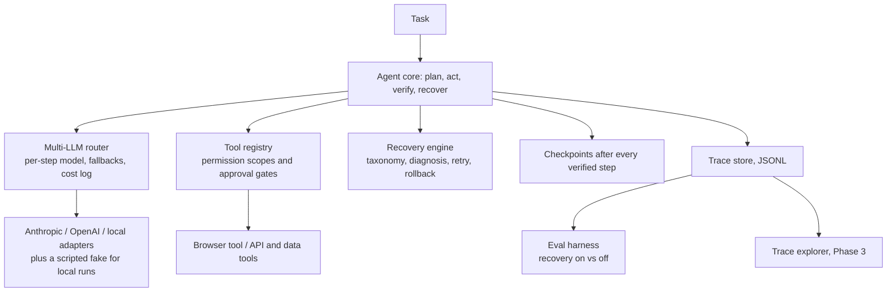

# Aegis

A permissioned tool-using agent runtime.

Aegis runs multi-step tasks with an LLM in the loop, under three rules
that are enforced by code, not by prompts:

- **Nothing irreversible happens without a human yes.** Every tool
  declares a permission scope (read, write, act, spend). Irreversible
  tools are gated by a human approval decision, and the agent cannot
  retry its way around a denial.
- **Failures are classified and recovered, or the run stops honestly.**
  A checkpointed state machine (plan, act, verify, recover) with a
  failure taxonomy, strategy-changing retries, and rollback to the last
  verified checkpoint.
- **Every run is fully traced, and every published number comes from the
  eval harness.** Traces are JSONL: every step, tool call, model call,
  and recovery event. No results are claimed from anything else.

It includes a browser and computer-use arm that grounds page elements by
role and label instead of coordinates, verifies after every action, and
feeds its failures into the same recovery engine; and a multi-LLM router
that picks a model per step kind (plan, act, verify, diagnose) across
providers, with fallback chains and per-call cost and latency logging.

Full design: [ARCHITECTURE.md](ARCHITECTURE.md). Build log, in the
builder's own words: [BUILD_JOURNAL.md](BUILD_JOURNAL.md).

## Architecture



## Run it locally

No API keys are needed. Local mode uses the scripted fake model adapter,
so the full loop runs deterministically.

```bash
make setup     # venv plus editable install
make test      # full suite, including the end-to-end smoke test
make smoke     # just the smoke test, verbose
make eval      # load and validate the example eval suite
```

Or with Docker:

```bash
docker compose up
```

The smoke test runs a two-step task (read a note, append a line to it)
through the planner, the permissioned registry, verification,
checkpointing, and tracing, then reads the trace back and checks it.

## Results

Results will appear here only after the eval harness has run the task
suite, computed from traces, with the suite version and model route named
next to the numbers. Until then this section stays empty on purpose.

| Suite | Tasks | Recovery | Pass rate | Mean cost per task | Mean latency per task |
| --- | --- | --- | --- | --- | --- |
| (no runs yet) | | | | | |

## Status

Phase 1 (current): scaffold, agent core, permissioned registry, recovery
engine, trace store, fake-model local mode, eval suite format, tests.

Phase 2: real provider adapters (Anthropic, OpenAI, local), the browser
tool with a local test site, eval execution and scoring, the recovery
on/off ablation over the full suite.

Phase 3: trace explorer UI, larger task suites, hosted demo.
