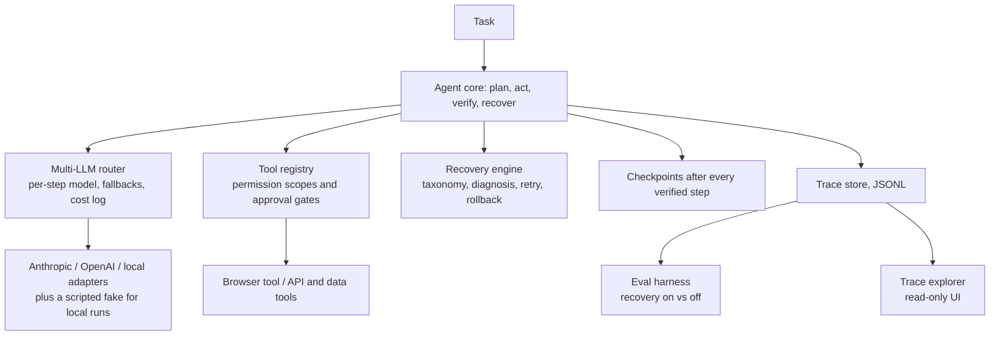

# Aegis

A permissioned agent runtime: approval gates for irreversible actions,
verify-after-step, classified recovery with checkpoints, full JSONL
tracing, and results that come only from the eval harness.

Aegis runs multi-step tasks with an LLM in the loop, under three rules
that are enforced by code, not by prompts:

- **Nothing irreversible happens without a human yes.** Every tool
  declares a permission scope (read, write, act, spend). Irreversible
  tools are gated by a human approval decision, and the agent cannot
  retry its way around a denial.
- **Failures are classified and recovered, or the run stops honestly.**
  A checkpointed state machine (plan, act, verify, recover) with a
  failure taxonomy, strategy-changing retries, and rollback to the last
  verified checkpoint.
- **Every run is fully traced, and every published number comes from
  the eval harness.** Traces are JSONL: every step, tool call, model
  call, and recovery event. No results are claimed from anything else.

It includes a browser and computer-use arm that grounds page elements
by role and label instead of coordinates, verifies after every action,
and feeds its failures into the same recovery engine; and a multi-LLM
router that picks a model per step kind (plan, act, verify, diagnose)
across providers, with fallback chains and per-call cost and latency
logging.

## Case study

### Where Aegis comes from

Aegis is the larger, general-purpose build that grows directly out of
two projects on my resume. The first is my Agentic AI Framework for
Genetic Evidence Discovery: a multi-agent system (LangChain, LangGraph)
with retrieval that gathers evidence for a variant and returns a sourced
summary, designed evaluation-first on held-out data, and built to
decline what it cannot support with evidence instead of guessing. The
second is my Reproducible NGS Pipeline Development work, and the
production pipeline platform I run at Karyon Bio: QC and validation
gates at every stage, runs that reproduce exactly, and monitoring that
catches a failed run before a user does. My agent and browser-automation
work, where the hard problems were grounding, verification after every
action, and recovering from failures mid-task, is the third strand.

Aegis takes the same ideas off the genomics domain and builds the
runtime they point to. The evidence agent's decline-rather-than-guess
rule becomes permission gates and honest aborts. The pipeline platform's
stage gates become verify-after-step, and its reproducibility becomes
checkpoints and full traces. The recovery work becomes a classified
failure taxonomy with strategy-changing retries, measured with recovery
on and off instead of asserted. Same skills, same discipline, bigger
system: multi-agent orchestration, retrieval, evaluation design,
production pipelines, and automation that has to survive contact with
real interfaces.

### The problem

Agent demos fail in two uninteresting ways and one dangerous one. They
die on the first surprise: a button renders late, a label changes, a
form rejects a submit, a handle goes stale. Or they retry the identical
call until a budget runs out and call that resilience. The dangerous
failure is quieter: an agent with real tools does something
irreversible (a charge, a deletion, a send) that nobody approved,
because the only thing standing in its way was an instruction in a
prompt.

Aegis is the runtime layer that addresses all three: classify failures
and recover with a changed strategy, verify every step against
evidence, and put irreversible actions behind a gate that is code, not
text.

### The design

- **Permissioned tool registry.** Every tool declares a scope (read,
  write, act, spend), a run policy, and whether it is irreversible.
  Irreversible tools cannot execute without an approval decision; with
  no approval path configured they are blocked outright. A permission
  denial is classified as final by the recovery engine, so the agent
  can never retry around the gate.
- **Verify after every step.** A tool call is not a success until a
  programmatic check on its result passes. The browser arm verifies by
  page state (expected text, read-back values); the core verifies
  expected output before checkpointing the step.
- **Recovery with changed strategies.** Failures are classified
  (element_not_found, stale_state, tool_error, model_refusal, timeout,
  permission_denied, verify_failed) and the retry differs by kind:
  re-grounding for a missing element, a state re-read for stale state,
  a longer wait for a timeout, backoff for a transient tool error.
  Retries are bounded; the fallback is rollback to the last verified
  checkpoint, then an honest abort with the diagnosis in the trace.
- **Checkpoints and traces.** A checkpoint is saved after every
  verified step. Every state transition, model call (model, tokens,
  latency, cost, estimate flag), tool call, verification, and recovery
  event is one JSON line, readable by the eval harness and by the
  trace explorer (`python -m aegis.explorer`).

### The eval method

Suite `aegis-suite-v2`: 30 tasks, 16 browser tasks against a local test
site with designed hostile behaviors (late-rendering and renamed
buttons, a transiently rejecting form, a self-reordering list, flaky
and slow endpoints, a delete flow behind a confirmation page) and 14
API tasks against a note store and a spend tool, including tasks whose
correct outcome is a refused run. 13 tasks carry a designed-in mid-task
failure.

Each task runs twice against the full runtime: recovery enabled and
recovery disabled (the ablation). Scoring is mechanical, from final
state plus trace assertions: run status, note contents, charge ledger
length, server-side session state, and required or forbidden trace
events. Full method and per-run failure detail are in the results file
linked below.

### Results

Verbatim from
[evals/results/results_aegis-suite-v2_2026-11-13.md](evals/results/results_aegis-suite-v2_2026-11-13.md)
(run 2026-11-13, `make eval`):

Suite version: aegis-suite-v2 | Date: 2026-11-13 | Model: fake-scripted | Browser driver: Playwright (Chromium headless)

| Mode | Tasks run | Passed | Pass rate | Mean latency per run (s) | Recovery events per passed task |
| --- | --- | --- | --- | --- | --- |
| recovery on | 30 | 30 | 100.0% | 0.86 | 0.93 |
| recovery off | 30 | 17 | 56.7% | 0.50 | 0.35 |

| Task | Kind | Recovery on | Recovery off |
| --- | --- | --- | --- |
| b01-late-button | browser | pass | FAIL |
| b02-renamed-button | browser | pass | FAIL |
| b03-form-transient-rejection | browser | pass | FAIL |
| b04-stale-handle-list | browser | pass | FAIL |
| b05-flaky-report | browser | pass | FAIL |
| b06-slow-report | browser | pass | FAIL |
| b07-delete-refused-no-approval | browser | pass | pass |
| b08-delete-approved | browser | pass | pass |
| b09-delete-approval-declined | browser | pass | pass |
| b10-shop-order | browser | pass | pass |
| b11-clean-form | browser | pass | pass |
| b12-home-to-form | browser | pass | pass |
| b13-list-click-by-label | browser | pass | pass |
| b14-late-then-rename-chain | browser | pass | FAIL |
| b15-form-transient-second-person | browser | pass | FAIL |
| b16-slow-report-tight-budget | browser | pass | FAIL |
| a01-read-inbox | api | pass | pass |
| a02-append-line | api | pass | pass |
| a03-append-new-note-twice | api | pass | pass |
| a04-charge-refused-no-approval | api | pass | pass |
| a05-charge-approved | api | pass | pass |
| a06-charge-approval-declined | api | pass | pass |
| a07-flaky-append-once | api | pass | FAIL |
| a08-flaky-append-twice | api | pass | FAIL |
| a09-flaky-read-then-append | api | pass | FAIL |
| a10-missing-note-honest-failure | api | pass | pass |
| a11-seeded-multi-note | api | pass | pass |
| a12-charge-then-note | api | pass | pass |
| a13-flaky-charge-approved | api | pass | FAIL |
| a14-impossible-expectation | api | pass | pass |

The split is exactly where it was designed to be: all 13 tasks with a
designed-in failure pass with recovery on and fail with it off; the
benign and safety tasks pass in both modes, including the ones whose
correct outcome is a refused run.

### Honest limits

- **The planner in the v2 runs is scripted.** Each task's plan is fixed
  in its setup and returned by the fake model adapter, so these numbers
  measure the runtime (permission gates, browser tool, recovery), not a
  model's planning. No number here says the system would plan its way
  through an unfamiliar task.
- **The provider adapters are not yet live-key verified.** Anthropic,
  OpenAI, and local adapters are verified against stub transports and
  by their clean typed failure without keys. A run with a real model
  in the planner seat is the next honest step, and it needs a real
  API key.
- **The tasks are local and small.** The hostile behaviors were chosen
  to exercise the failure taxonomy, so the suite is partly a test of
  whether the system survives its own designer's traps. Costs are zero
  because the fake model is unmetered; real-adapter calls log estimated
  costs in their traces, flagged as estimates.
- **Timings are one machine's**, and the demo trace set is a selection
  of 8 of the 30 tasks, chosen to show the interesting beats.

### Dig deeper

- [ARCHITECTURE.md](ARCHITECTURE.md): the full design.
- [BUILD_JOURNAL.md](BUILD_JOURNAL.md): the build log, in the builder's
  own words, including what was considered and rejected.
- [demo/WALKTHROUGH.md](demo/WALKTHROUGH.md): the presenter script for
  the three-beat walkthrough demo (`make demo`).
- [evals/results/results_aegis-suite-v2_2026-11-13.md](evals/results/results_aegis-suite-v2_2026-11-13.md):
  the full results file, with per-run failure detail.
- Trace explorer: `make explorer`, then http://127.0.0.1:8765/ for the
  demo runs as timelines, recovery events in amber, gate refusals in
  red.

## Architecture



## Run it locally

No API keys are needed. Local mode uses the scripted fake model
adapter, so the full loop runs deterministically.

```bash
make setup     # venv plus editable install
make test      # full suite, including the end-to-end smoke test
make smoke     # just the smoke test, verbose
make eval      # run the full 30-task suite (recovery on/off) and write results
make demo      # the three-beat walkthrough demo, narrated from traces
make explorer  # trace explorer UI on the demo trace set (port 8765)
```

Or with Docker:

```bash
docker compose up
```

The smoke test runs a two-step task (read a note, append a line to it)
through the planner, the permissioned registry, verification,
checkpointing, and tracing, then reads the trace back and checks it.

## Status

Phase 1: scaffold, agent core, permissioned registry, recovery engine,
trace store, fake-model local mode, eval suite format, tests.

Phase 2: real provider adapters (Anthropic, OpenAI, local Ollama-style)
behind the adapter interface with price-table cost estimates; the
browser tool (Playwright/Chromium, semantic grounding,
verify-after-action, typed failures) with the local hostile test site;
eval execution and scoring with the recovery on/off ablation over a
30-task suite (30/30 on, 17/30 off).

Phase 3 (current): the walkthrough demo (three scored showcase beats
with narrated traces), the read-only trace explorer over the demo trace
set, and this case study. Next, gated on a real API key: a live-model
planner run over the suite, then larger suites with tasks not designed
around the recovery taxonomy.
