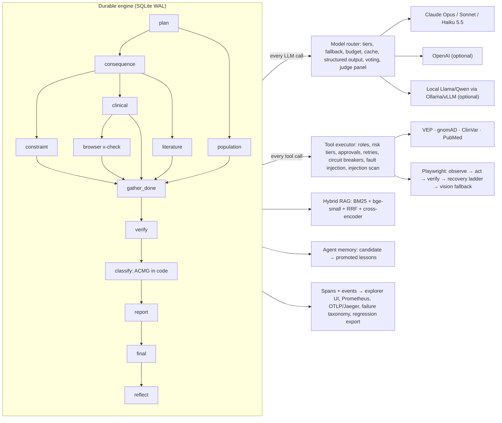
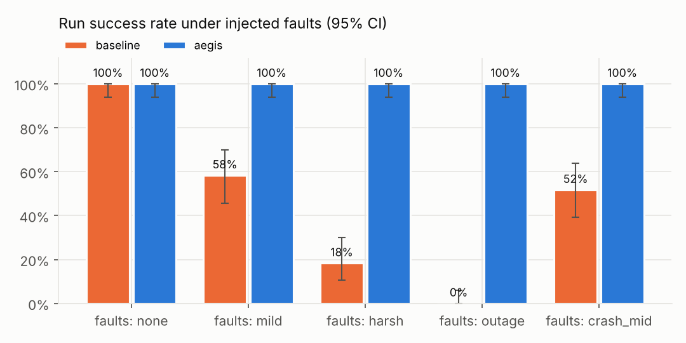
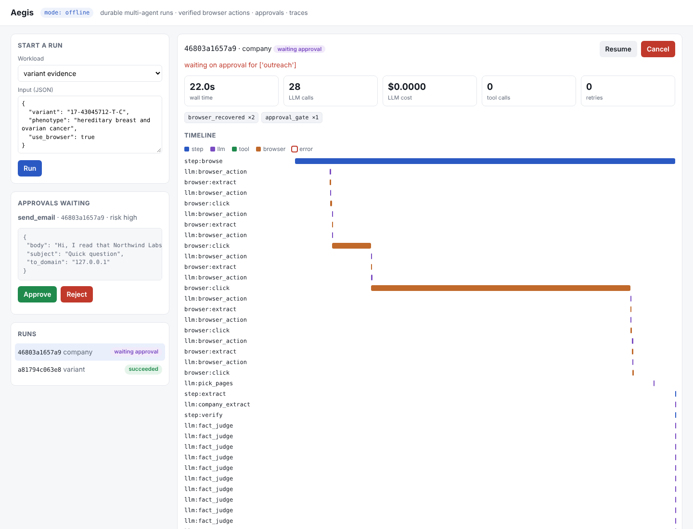

# Aegis

**A reliability runtime for AI agents that do real work.** Durable multi-agent execution, browser automation with verified effects, hybrid RAG, multi-model routing, guardrails enforced in code, human approvals, full tracing, and an evaluation harness that measures all of it.

Built by Umesh Linga, November 2026, as v2 of my *Agentic AI Framework for Genetic Evidence Discovery*. Written with AI pair-programming (Claude); every module is tested and every design decision is documented in `docs/`.

---

## The problem

Agent demos work on the happy path. Production agents fail in boring, expensive ways: an API rate-limits mid-run, the process dies between two steps, a button re-renders under the click, a model cites a paper that does not exist, a web page tells the agent to ignore its instructions, an action with real-world effect gets repeated after a retry. Aegis is the layer that makes those failures survivable, visible and measurable.

The same runtime drives two very different agents:

| Workload | What it does | Why it is here |
|---|---|---|
| **Variant evidence** (`aegis variant 17-43045712-T-C`) | Parallel specialist agents pull Ensembl VEP, gnomAD v4, ClinVar and PubMed, triage literature with RAG and self-consistency, verify every citation, score ACMG criteria **in code**, and either classify or explicitly decline. A browser agent cross-checks the ClinVar web page against the API. | Extends my genetic evidence agent: high-stakes, citation-heavy, many flaky upstreams. |
| **Company research** (`aegis company https://acme.com --outreach`) | A browser agent navigates a real website, captures pages, extracts facts with quotes, verifies each quote against the page, writes an account brief, and drafts outreach that can only be sent through a human-approved, exactly-once tool. | The job of an AI sales rep, which is where agents meet the open web, prompt injection and irreversible actions. |

## Architecture



**Rule of the system: the model decides *what*, code guarantees *how*.** Models plan, read, triage, extract and write. Code owns state transitions, retries, permissions, approval gates, citation checks, numeric grounding, ACMG combining, spend limits, and anything with an external effect. Details: [`docs/ARCHITECTURE.md`](docs/ARCHITECTURE.md).

## Results so far

Offline reliability eval, 60 cases per cell, same cases and same seeded faults for every system ([`docs/results/offline-2026-11-13`](docs/results/offline-2026-11-13/report.md)):

| Fault profile | Baseline agent success | Aegis success | Paired test |
|---|---|---|---|
| none | 100% | 100% | — |
| mild (≈10% of upstream calls fail) | 58% | 100% | p = 6e-08 |
| harsh (≈32% fail) | 18% | 100% | p = 4e-15 |
| full outage of PubMed + gnomAD constraint | 0% | 100% (degraded, declines where evidence is missing) | p = 2e-18 |
| process killed mid-step | 52% (restarts from scratch) | 100% (resumes, completed steps not redone) | p = 4e-09 |

Also measured: cited evidence that was real and quoted verbatim, 88% for the baseline (it accepts the injected fake PMIDs) vs 100% for Aegis; reports containing numbers that are not in the evidence, 16/60 vs 0/60. Ablations show which mechanism earns each number: retries carry the transient-fault results, graceful degradation carries the outage result, and self-consistency voting removed injected citations even before the verifier ran.





> **Read this before quoting numbers.** The offline eval uses synthetic fixtures and a deterministic stand-in model that injects hallucinations on purpose. It measures the *runtime*, not clinical accuracy and not real model behaviour. The live benchmark (ClinVar temporal split, real models, real APIs) is `make bench && make eval-live`; see [`docs/EVALS.md`](docs/EVALS.md). The browser tests run against a real Chrome on a local site built to be flaky (late JS navigation, an overlay that steals clicks, an injected instruction, an off-site link, a "Subscribe" button).

## Quickstart

```bash
git clone https://github.com/umeshlinga/aegis && cd aegis
python -m venv .venv && source .venv/bin/activate
make install                 # deps + Chromium
cp .env.example .env         # add ANTHROPIC_API_KEY (OpenAI / local model optional)
aegis doctor                 # checks keys, browser, VEP/NCBI/gnomAD, and pings each model tier

make test                    # 46 tests, no keys needed, includes real-browser tests
make eval                    # offline reliability eval -> evals/results/latest/report.html

aegis variant 17-43045712-T-C --phenotype "hereditary breast and ovarian cancer"
aegis company https://www.example.com --outreach      # parks for approval
aegis approvals && aegis approve 1                     # human decision, then resume
aegis serve                                            # explorer at http://127.0.0.1:8080
docker compose up --build                              # + Jaeger traces (:16686) + Prometheus (:9090)
```

## How this answers "show me the agent system you built"

| Question | Where the answer lives |
|---|---|
| An agent system I personally built | This repo. Engine, router, tools, browser agent, RAG, evals. `docs/BUILD_LOG.md` walks through every phase, command and decision. |
| Is it used in production? | **No.** It is a working system with tests, CI quality gates, Docker, metrics and tracing, run against live public APIs. It has no external users. I say that plainly. |
| A tricky execution or recovery failure I fixed, and how I measured it | `docs/FAILURES.md` logs every failure with symptom, root cause, fix and before/after numbers. Those found while building (with AI pair-programming) are marked as such; failures from live runs against real APIs and models are added as they happen. Example from the build: retry backoff was capped at 8s while the circuit breaker stayed open for 20s, so every retry hit an open breaker and the step failed even though the upstream had recovered. The harsh-fault eval exposed it; the fix lets the breaker's reset window drive the wait; Aegis harsh-profile success went 98.3% → 100% on the same 60 seeded cases. |
| Browser or computer-use automation | `src/aegis/tools/browser.py` and `agents/browser_agent.py`: LLM chooses actions, code verifies each effect and climbs a recovery ladder (settle → re-locate → scroll/force → JS click → vision-model coordinate click), with domain allowlists and irreversible-click refusal enforced in code. Tested in real Chrome. |

## Repository map

```
src/aegis/
  core/        engine.py (DAG, checkpoints, resume, cancel, approvals), store.py, resilience.py, faults.py, state.py, errors.py
  llm/         router.py (tiers, fallback, cache, structured output, voting, judge panel), providers.py, base.py
  tools/       registry.py (permissions, risk, approvals), browser.py, bio.py (VEP/gnomAD/ClinVar/PubMed), http.py
  agents/      browser_agent.py
  rag/         index.py (BM25 + dense + RRF + rerank), memory.py (lessons with promotion gate)
  guardrails/  injection.py, pii.py
  workloads/   variant/ (acmg.py, workload.py, fixtures.py), company/ (workload.py), registry.py
  evals/       harness.py, metrics.py, report.py, build_clinvar.py, judge_calibration.py
  tracing/     tracer.py (+ OTLP), taxonomy.py, export.py
  api/         server.py (FastAPI, Prometheus), explorer.html
  mcp_server.py, cli.py, services.py, config.py
tests/         46 tests incl. real-Chrome browser tests on tests/site
docs/          ARCHITECTURE, BUILD_LOG, MODELS_AND_TOOLS, DECISIONS, FAILURES, EVALS, LIMITATIONS, RUNBOOK, DEMO_SCRIPT, INTERVIEW_PREP
```

## Honest scope

ACMG coverage is a documented subset (BA1, BS1, PM2_Supporting, simplified PVS1, PP3/BP4 with calibrated REVEL thresholds, PS3/BS3 capped at Supporting). It is a research tool, not a clinical one. See [`docs/LIMITATIONS.md`](docs/LIMITATIONS.md).
