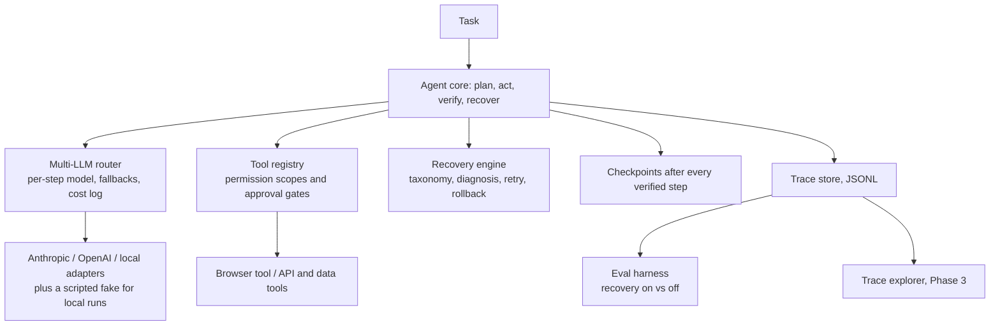

# Aegis

A permissioned tool-using agent runtime.

Aegis runs multi-step tasks with an LLM in the loop, under three rules
that are enforced by code, not by prompts:

- **Nothing irreversible happens without a human yes.** Every tool
  declares a permission scope (read, write, act, spend). Irreversible
  tools are gated by a human approval decision, and the agent cannot
  retry its way around a denial.
- **Failures are classified and recovered, or the run stops honestly.**
  A checkpointed state machine (plan, act, verify, recover) with a
  failure taxonomy, strategy-changing retries, and rollback to the last
  verified checkpoint.
- **Every run is fully traced, and every published number comes from the
  eval harness.** Traces are JSONL: every step, tool call, model call,
  and recovery event. No results are claimed from anything else.

It includes a browser and computer-use arm that grounds page elements by
role and label instead of coordinates, verifies after every action, and
feeds its failures into the same recovery engine; and a multi-LLM router
that picks a model per step kind (plan, act, verify, diagnose) across
providers, with fallback chains and per-call cost and latency logging.

Full design: [ARCHITECTURE.md](ARCHITECTURE.md). Build log, in the
builder's own words: [BUILD_JOURNAL.md](BUILD_JOURNAL.md).

## Architecture



## Run it locally

No API keys are needed. Local mode uses the scripted fake model adapter,
so the full loop runs deterministically.

```bash
make setup     # venv plus editable install
make test      # full suite, including the end-to-end smoke test
make smoke     # just the smoke test, verbose
make eval      # run the full 30-task suite (recovery on/off) and write results
```

Or with Docker:

```bash
docker compose up
```

The smoke test runs a two-step task (read a note, append a line to it)
through the planner, the permissioned registry, verification,
checkpointing, and tracing, then reads the trace back and checks it.

## Results

From the eval harness, run 2026-11-13 (`make eval`; full table and
per-task detail in
[evals/results/results_aegis-suite-v2_2026-11-13.md](evals/results/results_aegis-suite-v2_2026-11-13.md)).
Model route: the scripted fake model with a fixed plan per task, so these
numbers measure the runtime (permission gates, browser tool, recovery),
not a model's planning. Browser driver: Playwright (Chromium headless)
against the local hostile test site. Mean cost per task is zero because
the fake model is unmetered; real-adapter calls log estimated costs in
their traces, flagged as estimates.

| Suite | Tasks | Recovery | Pass rate | Mean cost per task | Mean latency per task |
| --- | --- | --- | --- | --- | --- |
| aegis-suite-v2 | 30 | on | 100.0% | $0.00 (fake model) | 0.86 s |
| aegis-suite-v2 | 30 | off | 56.7% | $0.00 (fake model) | 0.50 s |

Recovery events per passed task: 0.93 (on) vs 0.35 (off). All 13 tasks
with a designed-in mid-task failure pass with recovery on and fail with
recovery off; the benign and safety tasks pass in both modes, including
the ones whose correct outcome is a refused run.

## Status

Phase 1: scaffold, agent core, permissioned registry, recovery engine,
trace store, fake-model local mode, eval suite format, tests.

Phase 2 (current): real provider adapters (Anthropic, OpenAI, local
Ollama-style) behind the adapter interface with price-table cost
estimates; the browser tool (Playwright/Chromium, semantic grounding,
verify-after-action, typed failures) with the local hostile test site;
eval execution and scoring with the recovery on/off ablation over a
30-task suite.

Phase 3: trace explorer UI, larger task suites, hosted demo.
