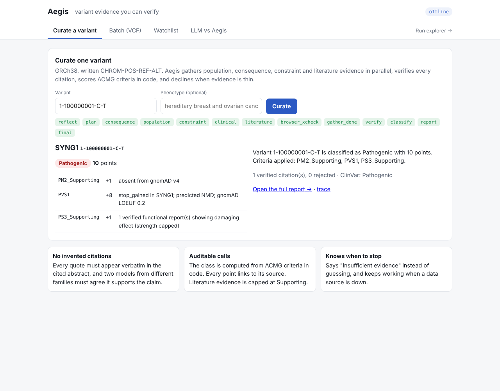
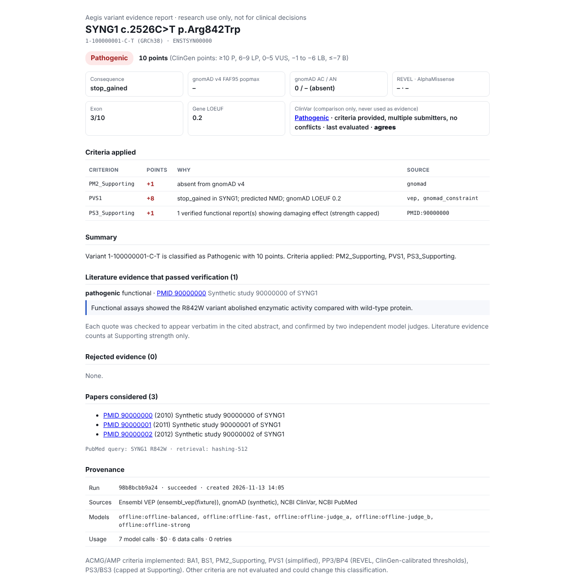
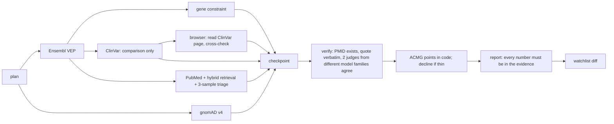

# Aegis

**Variant evidence you can verify.** Upload a VCF; every variant comes back with an ACMG-style call computed in code, every literature claim quoted verbatim from a real paper, an explicit "insufficient evidence" when that is the honest answer, and a watchlist that tells you when an old call should change.

Underneath is a reliability runtime for AI agents: durable multi-agent execution that survives crashes and flaky APIs, multi-model routing with budgets, browser automation that verifies every action, hybrid retrieval, guardrails enforced in code, human approvals, tracing, and an evaluation harness that measures all of it.

Built by Umesh Linga (bioinformatics + AI engineering), November 2026, with Claude as an AI pair-programmer. Research use only; not for clinical decisions.



---

## Why this exists

* Interpretation, not sequencing, is the bottleneck in clinical genomics, and it is still mostly manual. One lab measured ~90 minutes per case for full manual review.
* Asking an LLM directly is fast and wrong in a dangerous way: it invents citations and applies ACMG rules to evidence that doesn't exist, with high confidence.
* Classifications go stale: new papers and ClinVar updates change calls, and few tools re-check old ones.

Details and sources: [`docs/MARKET.md`](docs/MARKET.md). (The field is active; Aegis's angle is measured reliability, hard verification, and reanalysis, not "the first AI for variants".)

## What you can do with it

| | Command | Web app |
|---|---|---|
| Curate one variant | `aegis variant 17-43045712-T-C --phenotype "..."` | **Curate** tab |
| Curate a whole VCF / CSV, resumable | `aegis batch proband.vcf --name proband_042` → `results.tsv` + per-variant reports + batch page | **Batch** tab (upload) |
| Printable evidence report | `aegis report <run_id>` | links on every result |
| Watch variants for reclassification | `aegis watch add <variant> --note "family 7"`; `aegis watch run` (schedule weekly) | **Watchlist** tab |
| Compare against "just ask the LLM" | `aegis compare --cases evals/data/clinvar_benchmark.jsonl --n 30` | **LLM vs Aegis** tab |
| Research a company site (browser agent, approval-gated outreach) | `aegis company https://acme.com --outreach` | `/explorer` |
| Verified outreach vs plain-LLM outreach on real company sites | `aegis outreach-compare --sites examples/sites.txt --n 20` | report HTML |
| Use from Claude Desktop | `aegis mcp` | |
| Inspect any run: timeline, retries, failures | `aegis show <run_id>` | `/explorer` |



## How a variant is curated



**The model decides *what*; code guarantees *how*.** Models plan, read, triage and write. Code owns state, retries, permissions, approvals, citation checks, the classification, numeric grounding, spend limits, and anything with an external effect. [`docs/ARCHITECTURE.md`](docs/ARCHITECTURE.md).

## Evidence so far

**Reliability (offline, reproducible).** Same 60 cases and same seeded faults for each system; the baseline is the same code with every safety feature switched off ([report](docs/results/offline-2026-11-13/report.md)):

| Upstream condition | Baseline agent | Aegis |
|---|---|---|
| healthy | 100% | 100% |
| ~10% of calls fail | 58% | 100% |
| ~32% of calls fail | 18% | 100% |
| PubMed + gnomAD constraint down all run | 0% | 100% (degrades, declines where evidence is missing) |
| process killed mid-step | 52% (restarts from scratch) | 100% (resumes; finished steps not redone) |

Paired exact McNemar p < 1e-7 for every non-trivial row. Fake citations accepted: baseline 12%, Aegis 0%. Reports with numbers not in the evidence: 16/60 vs 0/60.


**Accuracy and the LLM-alone comparison (live; run these with your key).** The offline fixtures are synthetic, so they say nothing about clinical accuracy. Real numbers come from:

```bash
make bench                                  # ClinVar temporal split (train <= 2024-06-30 < test)
aegis compare --n 30                        # strongest model alone vs Aegis, scored against ClinVar
make eval-live                              # full eval, every model response recorded for free replay
```

## Install and run

```bash
python3 -m venv .venv && source .venv/bin/activate
pip install -e ".[dev,rag,mcp]" && python -m playwright install chromium
cp .env.example .env            # add ANTHROPIC_API_KEY; NCBI_EMAIL (+ NCBI_API_KEY) recommended
aegis doctor                    # checks keys, browser, Ensembl/NCBI/gnomAD, and each model tier
pytest -q                       # 53 tests, no keys needed, includes real-browser tests
aegis serve                     # web app http://127.0.0.1:8080   ops explorer /explorer   metrics /metrics
docker compose up --build       # + Jaeger traces :16686 + Prometheus :9090
```

Try it without keys: `aegis batch examples/demo_offline.vcf --mode offline`, then `AEGIS_MODE=offline aegis serve`. Step-by-step: [`docs/RUNBOOK.md`](docs/RUNBOOK.md).

## Inside

```
src/aegis/
  core/        durable engine: DAG, checkpoints, resume, cancel, approvals, stale-result CAS, exactly-once effects, faults
  llm/         router: tiers, provider fallback, budgets, per-run cache, structured output, voting, judge panel, vision
  tools/       permissioned tool executor; VEP, gnomAD, ClinVar, PubMed clients; Playwright browser with recovery ladder
  agents/      LLM-driven browser agent
  rag/         BM25 + bge-small + RRF + cross-encoder; agent memory with a promotion gate
  guardrails/  prompt-injection screening, PII redaction
  workloads/   variant (ACMG in code), company research, llm_only (comparison arm)
  batch.py · watch.py · reports/      the product features
  evals/       harness, metrics, comparison, ClinVar benchmark builder, judge calibration
  tracing/     spans (+ OTLP), failure taxonomy, regression export
  api/         FastAPI: product app, explorer, REST, Prometheus
  mcp_server.py · cli.py
tests/         53 tests incl. a deliberately flaky website driven by real Chrome
docs/          MARKET, ARCHITECTURE, MODELS_AND_TOOLS, BUILD_LOG, DECISIONS, FAILURES, EVALS, LIMITATIONS, RUNBOOK
```

## Scope

ACMG subset (BA1, BS1, PM2_Supporting, simplified PVS1, PP3/BP4 with calibrated REVEL thresholds, PS3/BS3 capped at Supporting), abstracts not full text, single-node durability, not in production. See [`docs/LIMITATIONS.md`](docs/LIMITATIONS.md) and the roadmap in [`docs/MARKET.md`](docs/MARKET.md).
