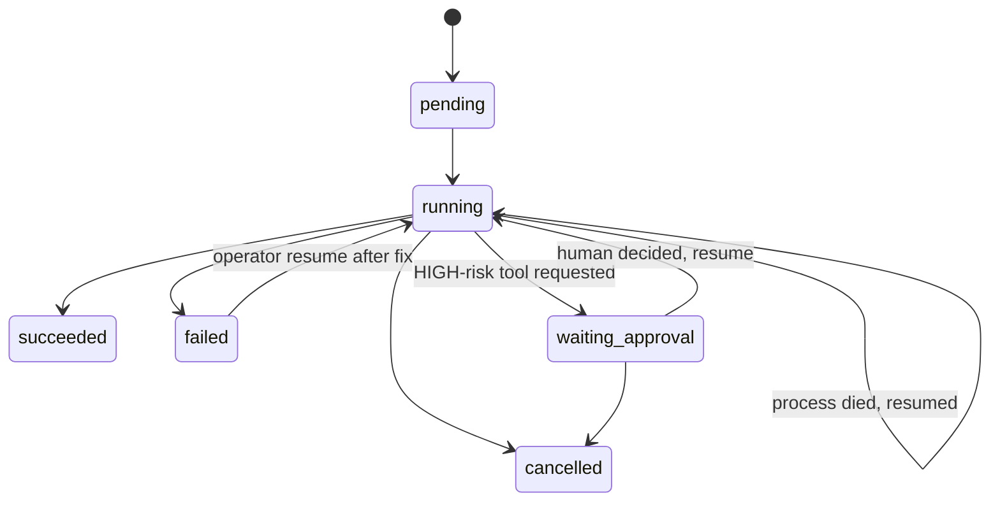

# Architecture

## 1. Layers

| Layer | Module | Responsibility | Guarantees enforced in code |
|---|---|---|---|
| Durable engine | `core/engine.py`, `core/store.py`, `core/state.py` | Runs a workload's DAG, parallel where deps allow, checkpointing every step | Legal state transitions only; completed steps never re-run on resume; stale attempts cannot overwrite newer ones (compare-and-set on attempt number); side effects at most once (effects ledger); cancellation honored between and during steps |
| Resilience | `core/resilience.py` | Retry, circuit breaker, loop guard, budget | Backoff with jitter; Retry-After honored; breaker waits drive retries; no repeated action loops; hard cost / call / deadline caps |
| Fault injection | `core/faults.py` | Seeded timeouts, 429s, 5xx, malformed responses, outages, crashes after or during a step | Same faults on every rerun, so systems can be compared on identical conditions |
| Model router | `llm/router.py`, `llm/providers.py` | Tiers (fast/balanced/strong/judge_a/judge_b), provider fallback, cache, structured output, self-consistency voting, cross-family judge panel | Every call budget-checked, traced, cached per run; invalid JSON repaired then escalated then rejected |
| Tools | `tools/registry.py`, `tools/bio.py`, `tools/http.py` | Real data sources behind a single executor | Role permissions, argument validation, risk tiers (HIGH needs a human), retries only for idempotent tools, per-host rate limits, untrusted output scanned |
| Browser | `tools/browser.py`, `agents/browser_agent.py` | LLM picks actions; session executes and verifies | Domain allowlist on every navigation and post-click URL; irreversible-looking controls refused; every action verified; 6-rung recovery ladder; loop guard |
| Retrieval & memory | `rag/index.py`, `rag/memory.py` | Hybrid search over abstracts / pages; lessons from past runs | Every chunk traceable to its source; new lessons inactive until promoted |
| Guardrails | `guardrails/injection.py`, `guardrails/pii.py` | Detect/strip injected instructions, spotlight untrusted text, redact PII | The real guarantee is permissions + approvals, not the detector |
| Workloads | `workloads/variant`, `workloads/company` | Domain logic | ACMG combining in code; model evidence capped; quotes verified verbatim; numbers in reports must exist in evidence |
| Observability | `tracing/*`, `api/server.py` | Spans, events, failure taxonomy, regression export, explorer UI, Prometheus, OTLP | Tracing failures never fail a run |
| Evaluation | `evals/*` | Systems × fault profiles × cases, paired statistics, calibration, judge agreement | Ground truth masked from the system under test |

## 2. Run lifecycle

Steps: `pending → running → succeeded | failed | skipped | cancelled | waiting_approval`. A step found `running` at startup belongs to a dead process; it is reset and re-run. That is safe because external effects go through `StepContext.effect(key, fn)`, which records the result under an idempotency key before returning.

## 3. One variant run, end to end

1. **plan** (Haiku, structured). Reads active lessons from memory. Decides whether literature and the browser cross-check are worth running. Code overrides: required evidence can never be skipped; the browser stays off if the operator disabled it.
2. **consequence / population** in parallel: Ensembl VEP (MANE/canonical transcript, HGVS, REVEL, AlphaMissense) and gnomAD v4 (AC, AN, FAF95 popmax).
3. **constraint / clinical / literature** in parallel once the gene is known. ClinVar is fetched for comparison only and masked during evals (it is the ground truth). Literature: PubMed search, abstracts fetched, chunked into a hybrid index, top passages retrieved, then **three samples** of Sonnet triage; only items seen in a majority of samples survive.
4. **browser_xcheck**: real Chrome opens the ClinVar variation page, reads the displayed classification (regex first, LLM fallback), and records a `source_disagreement` event if the page and API differ.
5. **gather_done**: barrier and checkpoint. The crash-injection point used in evals.
6. **verify**: PMID must be among fetched papers; quote must appear verbatim in that abstract; quote must not be an injected instruction; a **two-judge panel from different model families** must both agree the quote supports the claim.
7. **classify**: `acmg.classify` in plain Python. Functional evidence capped at Supporting unless a human approves more. Declines (`insufficient_evidence`) when required evidence is missing or only one weak criterion applies.
8. **report** (Opus): narrative from verified evidence only. Every number in the text must appear in the evidence JSON; otherwise one repair turn, then removal.
9. **final**, then **reflect** (lessons stored as candidates).

## 4. Company run, end to end

`browse` (browser agent loop with verification and recovery, plus an LLM-picked second pass over unvisited same-domain links) → `extract` (hybrid retrieval per field, Sonnet extraction with URL + exact quote) → `verify` (quote must exist on the captured page; judge panel) → `brief` (Opus, verified facts only) → `outreach` (Sonnet draft, PII redaction, then `send_email`, a HIGH-risk, non-idempotent tool: the run parks in `waiting_approval`; after approval it resumes and the send executes exactly once) → `final`.

## 5. Where the model decides vs where code decides

| Model decides | Code decides |
|---|---|
| Which optional sources to consult | Which sources are mandatory |
| Which link to click next, what to type | Whether the domain is allowed, whether the control is irreversible, whether the click had an effect |
| Which abstract sentences are functional evidence | Whether the PMID exists, whether the quote is verbatim, how much the evidence can weigh |
| Wording of reports, briefs and emails | Whether every number is grounded, whether PII is redacted, whether an email may be sent |
| Lessons worth remembering | Whether a lesson is active |
| — | Retries, timeouts, breakers, budgets, state transitions, final classification |

## 6. Concurrency details worth knowing

* Steps run as asyncio tasks, bounded by `max_parallel`. Tool calls inside a step can fan out (`asyncio.gather` for self-consistency samples, judge panels).
* Per-host rate limiter shared by all agents in a run keeps NCBI under 3 req/s (10 with a key).
* Stale results: if a step attempt times out and a newer attempt starts, the old attempt's `complete_step` is rejected by the attempt-number CAS and logged as `stale_result_discarded`.
* Cancellation is cooperative at the scheduler (checked every poll) and pre-emptive for in-flight tasks (`task.cancel()`), with steps marked `cancelled`.
* The LLM cache is scoped to the run, so a resumed run replays its own model outputs (deterministic and free) while separate runs never share answers (keeps eval costs honest).

## 7. Storage

One SQLite file (WAL mode): `runs, steps, events, approvals, spans, effects, llm_cache`, plus a sibling `*.memory.db` for retrieval-backed lessons. Plain SQL, no ORM, so moving to Postgres for many workers is a driver swap plus `SELECT ... FOR UPDATE SKIP LOCKED` for a work queue (ADR-002).
